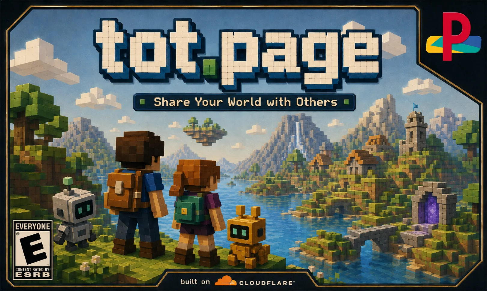

<p align="center">
  
  <br>
  <sub><a href="https://tot.page">tot.page</a> is what enables <a href="https://plannotator.ai/workspaces">Plannotator Workspaces</a></sub>
</p>

# tot.page

Publish a markdown or HTML file to a live link in one command. No signup.

The useful part is that it is **git-backed publishing**, not a one-off upload. The link you share is
living, like a branch: run `tot update` and the same URL moves forward. Every publish also creates a
real version with a frozen `@hash` URL, like a commit, so you can point people at either "latest" or
"exactly this snapshot."

```bash
npm i -g @plannotator/tot
```

```
tot notes.md
  ↳ https://tot.page/aB3xK9q
  commit  e5f6c1a
  frozen  https://tot.page/aB3xK9q/index.md@e5f6c1a
```

## Commands

| Command                 | What it does                                                                           |
| ----------------------- | -------------------------------------------------------------------------------------- |
| `tot notes.md`          | Publish markdown as the raw `.md` file.                                                |
| `tot page.html`         | Publish HTML as the raw `.html` file, plus local support files it directly references. |
| `tot update <link>`     | Push new content. The same link updates.                                               |
| `tot list`              | Show what you have published.                                                          |
| `tot remove <link>`     | Remove the living page from its share link.                                            |
| `tot login --key <key>` | Optional. Publish as an owned account instead of anonymous.                            |

## For AI agents

Agents can publish with zero install: the CLI is a thin wrapper over the HTTP API at
`https://api.tot.page`, and a drop-in [agent skill](skills/tot/SKILL.md) teaches the full
curl flow — publish, update, remove, HTML assets, ownership. Copy it into your agent's
skills directory:

```bash
cp -r skills/tot ~/.claude/skills/tot # or .cursor/skills/, ~/.agents/skills/, …
```

Plain API reference: [site/agents.md](site/agents.md). With the CLI installed the skill
uses `tot`; otherwise it falls back to curl.

## How it works

Files are served byte for byte. Markdown comes back as raw markdown. HTML comes back as raw HTML.

For HTML, `tot` also uploads direct local browser dependencies before the page goes live: images,
stylesheets, scripts, video, `srcset` entries, and video posters. It skips external URLs and ordinary
navigation links. There is no config file, build step, routing layer, or bundler.

Your link is live. Run `tot update` and the same `tot.page/...` link shows the new version. Every version also keeps a frozen `@hash` link that never changes, for when you want a fixed snapshot.

`tot remove` removes the living page. Frozen snapshot links are permanent while the workspace exists.

No accounts, no tokens. The link is the key. Treat them as you would excalidraw.

> A page you publish is open. Anyone who has the link can view it, update it, or delete it. There is no private mode. Share the link with that in mind.

## Configuration

State lives in `~/.tot`: the API endpoint and the list of pages you have published. Override the API origin for one run with `--endpoint <url>`. Content links remain on `tot.page`; the API origin defaults to `api.tot.page`, the live tot publish backend.

## Built on

[Cloudflare Artifacts](https://www.cloudflare.com/products/artifacts/). Every version is a real git commit.

## License

MIT
